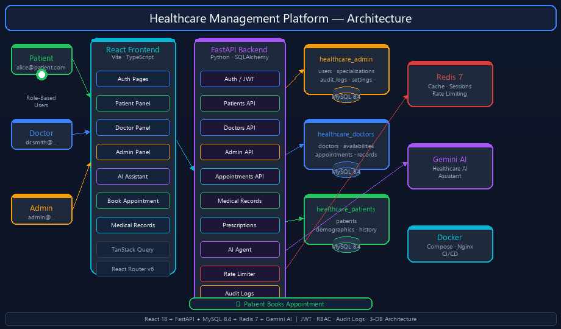

# Healthcare Management Application

<p align="center">
  
</p>

A secure, modular, production-oriented healthcare management platform built with React 18, FastAPI, MySQL 8.4, Redis, and Gemini AI — featuring role-based dashboards for Patients, Doctors, and Admins across a 3-database architecture.

## Modules

| Module | Description |
|---|---|
| Patient Management | Registration, login, profile, medical history, dashboard |
| Doctor Management | Profiles, specializations, availability, scheduling |
| Appointment Management | Book, cancel, reschedule, reminders |
| EHR | Medical records, prescriptions, lab reports, document uploads |
| Admin Dashboard | User management, statistics, audit logs |
| AI Healthcare Assistant | Health Q&A, document summarization, appointment help |

## Tech Stack

- **Frontend**: React 18, TypeScript, Vite, Tailwind CSS, TanStack Query v5, Framer Motion
- **Backend**: Python, FastAPI (async), SQLAlchemy 2.x, Pydantic v2
- **Database**: MySQL 8.4 — 3 separate databases (admin / doctors / patients)
- **Cache / RT**: Redis 7 (sessions, rate limiting, pub-sub)
- **AI**: Google Gemini API (primary healthcare assistant)
- **Infrastructure**: Docker, Docker Compose, GitHub Actions, Nginx

## Quick Start

### Prerequisites
- Docker and Docker Compose
- Node.js 20+ (for local frontend dev)
- Python 3.11+ (for local backend dev)

### Run with Docker

```bash
cp .env.example .env
# Edit .env with your values (especially ANTHROPIC_API_KEY and POSTGRES_PASSWORD)
docker compose up -d
```

- Frontend: http://localhost:5173
- Backend API: http://localhost:8000
- API Docs: http://localhost:8000/docs

### Local Development

**Backend**
```bash
cd backend
python -m venv venv
source venv/bin/activate   # Windows: venv\Scripts\activate
pip install -r requirements.txt
cp ../.env.example ../.env
alembic upgrade head
python -m backend.app.db.seed  # optional seed data
uvicorn app.main:app --reload --port 8000
```

**Frontend**
```bash
cd frontend
npm install
npm run dev
```

### Run Tests

```bash
# Backend
cd backend && pytest -v

# Frontend
cd frontend && npm run test

# E2E
cd frontend && npx playwright test
```

## Roles

| Role | Capabilities |
|---|---|
| `PATIENT` | Own profile, own appointments, own medical records, AI assistant |
| `DOCTOR` | Own profile, assigned patients, appointment management |
| `RECEPTIONIST` | Book/manage appointments, view doctor availability |
| `ADMIN` | Full system access, user management, audit logs |

## Security

- JWT authentication with short-lived access tokens (15 min) and refresh token rotation
- Role-based access control on every endpoint
- Patients can only access their own data
- All sensitive operations are audit-logged
- No real patient data used during development — synthetic data only

## Project Structure

See [docs/architecture.md](docs/architecture.md) for full architecture documentation.

## Development Phases

See [docs/development-plan.md](docs/development-plan.md) for the phased development roadmap.

---

> **Important**: This application is not certified for healthcare compliance (HIPAA, DPDP, etc.) out of the box. Before deploying in a real healthcare environment, conduct a thorough compliance assessment.
